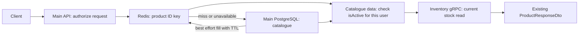

# Redis product-detail cache

## Scope and changed files

Main API (`scalable-ecommerce-backend`, local folder `e-commerce`):

| File | Purpose |
| --- | --- |
| `package.json`, `package-lock.json` | Pin one Redis client: `ioredis@5.11.1`, compatible with the existing TypeORM optional peer requirement and Node 24. |
| `.env.example` | Document optional `REDIS_URL` and `PRODUCT_CACHE_TTL_SECONDS=60`. An absent URL disables caching. |
| `src/products/product-cache.service.ts` | Cache reads, serialization/date hydration, TTL writes, targeted invalidation and bounded Redis failure handling. |
| `src/products/products.module.ts` | Register the cache provider. |
| `src/products/products.service.ts` | Cache details only and invalidate after successful product writes. |
| `src/products/categories.service.ts` | Invalidate related product entries after a category update succeeds. |
| `test/product-cache.e2e-spec.ts` | Focused Redis adapter tests using a mocked client. |
| `test/products.e2e-spec.ts` | Extend existing HTTP tests for cache flows, stock, authorization, invalidation and authoritative checkout pricing. |
| `docs/redis-product-cache.md` | This implementation and operations report. |

Inventory repository (`scalable-ecommerce-inventory-service`, local folder `inventory-service`):

| File | Purpose |
| --- | --- |
| `compose.local.yaml` | Add private, disposable `redis:8.8.4-alpine`, a health check and Main API cache settings/dependency. |
| `.env.example` | Document the TTL consumed by the local Compose stack. |

No database schema, migration, Inventory application code, gRPC contract, controller or order workflow was changed for this feature.

## Architecture and cache contents



Only `ProductsService.findOneOrFail()` uses the display cache. `findAll()` continues its existing database/filter/pagination path. `findByIds(ids, manager?)` continues to read PostgreSQL directly, including through a supplied transaction manager.

Keys are `product:{actualProductId}`. The value is a versioned JSON envelope containing catalogue fields selected through the existing product DTO: ID, name, description, price, category ID/details, active flag, image metadata, and timestamps. `availableQuantity` is omitted. On a hit, product/category timestamps become `Date` objects again, and malformed or incompatible values are treated as misses. Entities are reconstructed from explicitly selected fields; arbitrary cached fields are not copied into the returned entity.

Redis is shared by Main API instances on the internal Compose network. It has no published port and no application data volume. Snapshot and AOF persistence are disabled; memory is capped at 128 MB with `allkeys-lru` eviction. Losing Redis only loses cached catalogue copies. PostgreSQL volumes are preserved.

## Request and invalidation flows

| Event | Behavior |
| --- | --- |
| MISS | Read product with category/images from Main PostgreSQL; enforce visibility; best-effort Redis `SET ... EX ttl`; continue through existing stock integration. |
| HIT | Hydrate cached catalogue data; enforce visibility for the current user; continue through existing stock integration. |
| TTL expiry or eviction | Next Redis read misses and PostgreSQL supplies the product again. Hits do not extend TTL. |
| Missing product or rejected visibility | Preserve `NotFoundException`; no negative/error cache entry is created. |
| Product creation | Save normally, invalidate its ID after success, then retain the existing reload/response flow. |
| Product update | Await successful completion of the existing transaction, then invalidate its ID, then retain the reload/response flow. Failed transactions do not invalidate. |
| Product deletion | Preserve foreign-key restrictions and error handling; invalidate only after successful deletion. |
| Category update | Save successfully, select only IDs of products with that `categoryId`, and delete those product keys in batches of 250. No Redis-wide scan/flush. |
| Category create/delete | New categories have no existing product cache dependency. PostgreSQL refuses deletion while products reference a category, so a successful deletion has no current dependent products. |
| Redis unavailable | Reads fall back to PostgreSQL; cache fills and invalidation are best-effort. Failures are logged without connection URLs or credentials. |

`PRODUCT_CACHE_TTL_SECONDS` defaults to 60 and accepts integers from 1 through 86400. Redis connection timeout is 500 ms, each command timeout is 250 ms, offline command queuing and replay are disabled, and requests do not wait for reconnect. Reconnection happens in the background. A timeout bounds each Redis command, not the full database/gRPC response time.

For Compose, set the TTL in Inventory's ignored `.env` (or the invoking shell); Main's host `.env` is not Compose's interpolation source. For running Nest directly outside Compose, use Main's `.env`. The Redis container intentionally has no host port, so a host-run API needs a separately reachable Redis URL or can leave caching disabled.

The local Compose startup waits for Redis health. If Redis goes away after API startup, the API continues using PostgreSQL. Removing `REDIS_URL` allows the application itself to start with caching disabled outside this Compose setup.

## Correctness and remaining risks

- Authorization guards remain in place. Role-neutral catalogue data is checked against the current user's role on every hit/miss: an inactive cached product remains hidden from CUSTOMER and visible to RESPONSIBLE.
- Inventory quantities remain owned by Inventory and are retrieved through the existing `responseWithStock()` integration for every detail response. No quantity or stock failure is stored in the product cache.
- Checkout pricing and price snapshots bypass this cache through the unchanged PostgreSQL `findByIds()` path. Reservations and compensation are unchanged.
- DTO structure, integer IDs, decimal price numbers, images and timestamp output are preserved.
- **This design does not guarantee strict read-after-write consistency.** A reader may load an old database value before an update, then refill the cache after the writer deletes it. Concurrent updates and cache fills can therefore restore stale display data until TTL expiry.
- If invalidation fails during a Redis outage, old entries can become visible when Redis recovers, until their TTL expires. This also applies to a previously active cached product after a failed deactivation invalidation. The role check enforces the flag in the retrieved value; it cannot prove that cached data is the latest database version.
- Other writers (manual SQL, seeds, future services) must invalidate affected keys or accept TTL-bounded display staleness. TTL is not an immediate consistency guarantee.
- There is no cache-fill deduplication, so simultaneous misses may perform duplicate catalogue reads. This is an efficiency issue, not a pricing-authority change.
- Category invalidation loads the matching IDs into memory before batched Redis deletion; paginate this ID lookup if categories later contain very large product counts.
- For tighter consistency, the next small design step is generation/version checks around cache fills plus reliable retries of failed invalidation. Durable invalidation delivery or an outbox is needed if outages must never lose invalidation. These were intentionally not added to this first implementation; no distributed locking system is introduced.
- PostgreSQL and Inventory outages still follow their existing behavior. Redis fallback cannot repair those dependencies.

## Validation

Executed locally:

```powershell
npm.cmd run test:e2e -- --runInBand products.e2e-spec.ts product-cache.e2e-spec.ts orders.e2e-spec.ts
```

Result: 3 suites, **76 tests passed**. These HTTP tests use mocked repositories and a mocked JWT guard; the existing roles guard, validation, controllers and services run normally. Adapter tests mock the Redis client. They cover miss/fill/hit, stock calls on each read, inactive-product visibility, failed/successful updates, post-transaction invalidation, deletion/FK refusal, category invalidation, checkout price reads, date hydration, malformed values, configured expiry, and best-effort Redis errors.

```powershell
node.exe node_modules/typescript/bin/tsc --noEmit --incremental false -p tsconfig.build.json
```

Result: passed without diagnostics.

Live Docker verification used the compiled service, actual Main PostgreSQL and actual Redis, with a temporary one-second TTL in the probe process only:

| Check | Observed result |
| --- | --- |
| First detail read (MISS) | 2 catalogue SQL statements |
| Repeated detail read (HIT) | 0 catalogue SQL statements |
| Read after actual Redis expiry | 2 catalogue SQL statements |
| `findByIds()` while display cache exists | 1 PostgreSQL statement |
| Read after the probe's Redis client disconnects | 2 catalogue SQL statements; success |
| Product/category invalidation | Corresponding Redis entries removed |
| Cached stock | `availableQuantity` absent from the value |
| Real HTTP detail reads with Redis running | HTTP 200 twice |
| Real HTTP detail reads while Redis was stopped | HTTP 200 twice; PostgreSQL fallback |
| Redis after the outage check | Restarted, healthy, `PONG` |

The live HTTP fixture selected product 8 and returned `availableQuantity: null`. A read-only query to Inventory's database confirmed that product 8 has no `inventory_stock` row. Inventory was healthy; no stock rows were inserted or changed. The automated HTTP test separately verifies that both a HIT and a MISS call the Inventory client and that changed stock is reflected in the next response.

The temporary probes were piped into `docker compose -f compose.local.yaml exec -T api node -`. The outage probe used `docker compose -f compose.local.yaml stop redis`, followed by restart in a PowerShell `finally` block. No k6 load test, Azure action, migration execution, database reset or destructive cleanup was performed. Product/category database writes in the HTTP tests were mocked; live checks used reads and disposable Redis keys only. The local API, Redis, PostgreSQL and Inventory containers were left running.

## Local PowerShell commands

Run each command separately. Start in the Inventory repository, which owns the local Compose stack:

```powershell
Set-Location -LiteralPath "E:\The Last Year\First Semester\تطبيقات الانترنت\inventory-service"
```

With the existing PostgreSQL and Inventory containers already running, build Main and start Redis/API without rerunning migration jobs:

```powershell
docker compose -f compose.local.yaml build main-migrate
```

```powershell
docker compose -f compose.local.yaml up -d --wait redis
```

```powershell
docker compose -f compose.local.yaml up -d --no-deps --wait api
```

`build main-migrate` builds the shared `ecommerce-local` image; building does not execute migrations. `--no-deps` assumes the existing Main schema and Inventory service are ready. For the usual full-stack startup, `docker compose -f compose.local.yaml up -d --wait` preserves the existing dependencies and runs any pending local migration jobs.

Confirm Redis health:

```powershell
docker compose -f compose.local.yaml ps redis
```

```powershell
docker compose -f compose.local.yaml exec -T redis redis-cli ping
```

Expected: healthy and `PONG`.

Authenticate using the existing performance manager (no password is committed):

```powershell
$cachePassword = [System.Net.NetworkCredential]::new('', (Read-Host 'Performance manager password' -AsSecureString)).Password; $loginBody = @{ email = 'perf.v1.manager@example.com'; password = $cachePassword } | ConvertTo-Json; $session = Invoke-RestMethod -Method Post -Uri 'http://localhost:3000/auth/login' -ContentType 'application/json' -Body $loginBody; $headers = @{ Authorization = "Bearer $($session.accessToken)" }; Remove-Variable cachePassword, loginBody
```

Select an actual product ID from the catalogue (choose a demo product for later write examples):

```powershell
$catalogue = Invoke-RestMethod -Uri 'http://localhost:3000/products?page=1&limit=1' -Headers $headers; $productId = $catalogue.data[0].id
```

Force a MISS by deleting just that disposable cache entry, then read the product:

```powershell
docker compose -f compose.local.yaml exec -T redis redis-cli DEL "product:$productId"
```

```powershell
$product = Invoke-RestMethod -Uri "http://localhost:3000/products/$productId" -Headers $headers; $product
```

Inspect the newly filled entry and TTL:

```powershell
docker compose -f compose.local.yaml exec -T redis redis-cli GET "product:$productId"
```

```powershell
docker compose -f compose.local.yaml exec -T redis redis-cli TTL "product:$productId"
```

Repeat the detail request within TTL for a HIT:

```powershell
Invoke-RestMethod -Uri "http://localhost:3000/products/$productId" -Headers $headers
```

To observe Redis operations directly, run this briefly in a second terminal from the same directory, then repeat the MISS/HIT commands in the first terminal:

```powershell
docker compose -f compose.local.yaml exec redis redis-cli MONITOR
```

The initial detail read shows `GET` then `SET ... EX`; the repeated hit shows `GET` without a refill `SET`. Stop monitoring with Ctrl+C. This is a manual diagnostic, not a benchmark. A Redis hit alone does not prove that the whole HTTP request executes zero SQL: authentication can still read the current user.

Safely list only the relevant cache namespace:

```powershell
docker compose -f compose.local.yaml exec -T redis redis-cli --scan --pattern 'product:*'
```

After waiting beyond the configured TTL, `EXISTS` returns 0; the next detail read refills the entry. `TTL=-2` means absent. Avoid `FLUSHALL`, `FLUSHDB`, `KEYS *`, or volume deletion.

### Manually verify update invalidation

These commands intentionally update a chosen local demo product and then restore its name. They are provided for manual use and were not used to modify existing records during the live cache verification.

```powershell
$originalName = $product.name; $patchBody = @{ name = "$originalName (cache demo)" } | ConvertTo-Json; Invoke-RestMethod -Method Patch -Uri "http://localhost:3000/products/$productId" -Headers $headers -ContentType 'application/json' -Body $patchBody
```

```powershell
docker compose -f compose.local.yaml exec -T redis redis-cli EXISTS "product:$productId"
```

Expected: 0 after the PATCH, provided no concurrent reader has already refilled the key. Read the detail again to see the updated name and refill the cache:

```powershell
Invoke-RestMethod -Uri "http://localhost:3000/products/$productId" -Headers $headers
```

Restore the original name:

```powershell
Invoke-RestMethod -Method Patch -Uri "http://localhost:3000/products/$productId" -Headers $headers -ContentType 'application/json' -Body (@{ name = $originalName } | ConvertTo-Json)
```

### Optional outage check

With a valid token, this briefly stops only the disposable Redis service, reads the product via PostgreSQL fallback, and restarts Redis even if the request fails:

```powershell
docker compose -f compose.local.yaml stop redis; try { Invoke-RestMethod -Uri "http://localhost:3000/products/$productId" -Headers $headers } finally { docker compose -f compose.local.yaml up -d --wait redis }
```

## Future Azure deployment (not performed)

- Provision a private Redis endpoint reachable by Main API; choose a supported service/image and capacity/eviction policy.
- Use TLS (`rediss://`), authentication/ACLs and secret management. Do not publish Redis to the Internet.
- Set `REDIS_URL` and the intended TTL on Main API instances; keep Inventory ownership and PostgreSQL checkout pricing unchanged.
- Define whether TTL-bounded display staleness is acceptable. Add version-aware fills and reliable invalidation delivery before promising strict consistency.
- Build/deploy Main only through the normal reviewed process; monitor Redis connection errors, hit/miss rates, latency, memory/eviction and stale-data incidents.
- All Main instances that share keys must use the same cache schema and invalidate on every relevant write. A dedicated Redis database/namespace avoids key collisions with other applications.

References: [ioredis connection and timeout options](https://redis.github.io/ioredis/interfaces/CommonRedisOptions.html), [official Redis Docker image](https://hub.docker.com/_/redis).
